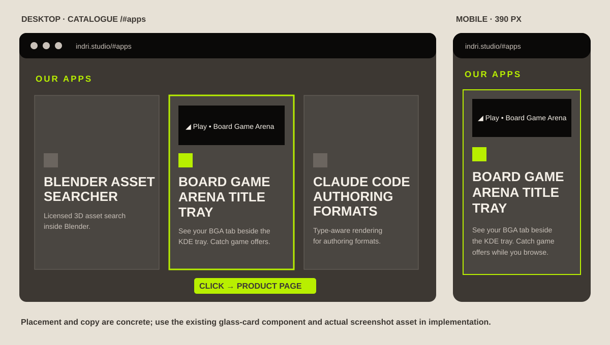
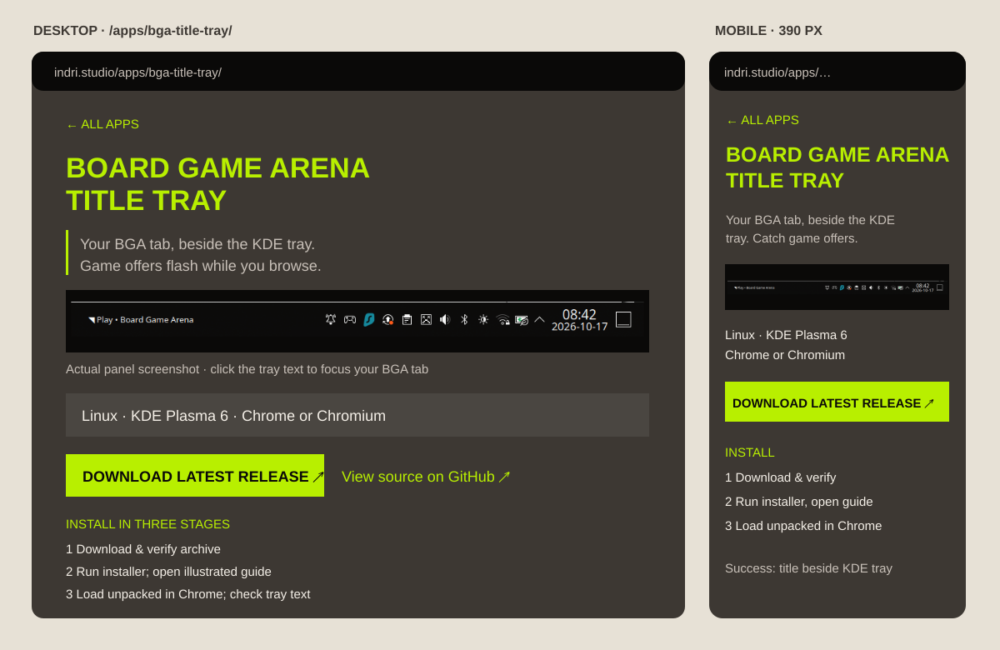
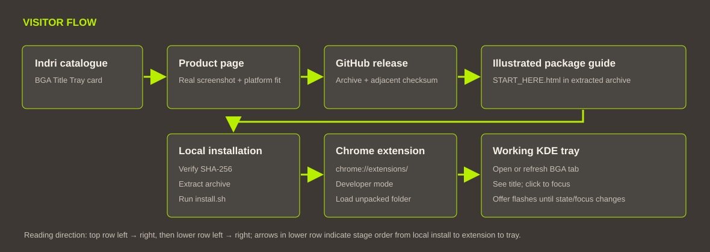

# Board Game Arena Title Tray in the Indri catalogue

## Goal and fit

Add Will's released **Board Game Arena Title Tray** to the [Indri app catalogue](https://indri.studio/#apps). A visitor should understand the utility in one card, see a real working panel on its detail page, know that this release supports **Linux + KDE Plasma 6 + Google Chrome or Chromium**, and reach the published archive and illustrated install guide without looking through source files. Identify it as an independent companion for [Board Game Arena](https://boardgamearena.com/), not a Board Game Arena product.

This is a catalogue and documentation change. The download stays on the [project's GitHub releases](https://github.com/wbniv/bga-title-tray/releases/latest); Indri does not host an installer or imply Windows, macOS, Firefox, Safari, Edge, or GNOME support.

## Existing site pattern

The homepage's “our apps” grid reads `src/content/apps/*.md`, sorts entries alphabetically, and links each card to `/apps/<slug>/` unless `externalUrl` is set. The shared detail page renders the entry's summary, body, screenshot gallery, and optional GitHub badge. The [current live catalogue](https://indri.studio/#apps) has no entry for this utility. Add an ordinary internal detail page so the user can review platform support and installation steps before following the release link. Keep the existing Indri palette and card component; no new catalogue UI component is needed.

## Published archive check

The published `v0.4.3` archive was smoke-tested in a disposable Ubuntu 26.04 container with Plasma 6 and Chrome 154 before drafting the catalogue claims:

- [x] Downloaded archive matched its published SHA-256 file; the unprivileged installer registered the native host and added the panel widget.
- [x] Loaded the packaged extension with its fixed ID, connected Chrome to the native host, opened a Board Game Arena tab, and observed that tab's real title and focus state through the installed status command.
- [x] Triggered the manual tray flash preview and saw its active state clear; removed the unpacked extension and verified the uninstaller removed the host registrations, runtime, and widget.

The test browser used a custom `--user-data-dir`, so Chrome looked for its per-user native-host manifest inside **that profile's** `NativeMessagingHosts` directory. The installer registers the documented default Chrome profile location; the test harness copied that manifest into the custom profile to complete the connection. This was a test setup difference, not a release change. [Chrome's native-messaging documentation](https://developer.chrome.com/docs/extensions/develop/concepts/native-messaging#native-messaging-host-location) explains the profile-relative lookup.

## Screen mockups

These are layout contracts, not screenshots of a deployed page. Green follows Indri's accent; the product capture is the real tray screenshot in `boardgamearena.com/codex/screenshots/bga-title-tray-working.png`.

[](2026-10-17-bga-title-tray-catalogue/catalogue-mockups.svg)

[](2026-10-17-bga-title-tray-catalogue/detail-mockups.svg)

The card title is **Board Game Arena Title Tray**; proposed summary: “See your Board Game Arena tab beside the KDE tray. A game offer flashes there while you browse.” The detail page starts with the real working panel image and a short explanation, then shows the supported setup and an obvious **Download latest release** link. Installation is a short ordered path with a link to the package's illustrated `START_HERE.html` guide after download; do not make the visitor read Markdown. Show that Chrome's **Load unpacked** step is required, and make `chrome://extensions/` easy to copy if a browser blocks the link.

## Visitor and release flow

[](2026-10-17-bga-title-tray-catalogue/visitor-flow.svg)

The release URL is stable across versions. The detail page should link to `https://github.com/wbniv/bga-title-tray/releases/latest` and the project repository, while version-specific file names and checksum commands remain in the versioned guide. If the guide is only inside the archive, state that plainly in step 1. The detail page may link directly to the GitHub-rendered `codex/START_HERE.html` source only as an optional preview; its images and browser behavior must be checked before promising that it works outside the archive.

## Implementation sequence

- [x] Add `src/content/apps/bga-title-tray.md` with the title, date, concise summary, GitHub link, and an internal detail page. The existing collection supplies alphabetical catalogue ordering.
- [x] Copy the real tray screenshot into `src/assets/screenshots/bga-title-tray/` and show it with descriptive alt text near the top of the detail page. Use dedicated SVG card art because the 900 × 54 screenshot becomes unreadable as a card background; preview the art in its actual grid slot.
- [x] Write the detail page with a concrete use case, what flashes and when it stops, supported platforms, a clear release CTA, and the three essential installation stages: download/check archive, run installer, load the unpacked extension. Link Board Game Arena, the GitHub release, the repository, and the browser extension page where possible.
- [x] Keep product copy accurate to the published archive and its documented default-profile install path. Use the stable latest-release URL so version-specific commands stay in the archive's illustrated guide.
- [x] Add a `TODO.md` pointer to this plan per the Indri workflow and, after the creation commit exists, update `docs/plans/README.md` with its commit reference.
- [x] Build with `task build`, inspect the rendered catalogue at desktop and mobile widths, and verify the card, detail page, screenshot, links, keyboard focus, and no horizontal overflow. Compare release text against the actual archive and installed guide.
- [x] Publish through the repository's normal tag-driven deployment and verify the live `/#apps` card, `/apps/bga-title-tray/` page, image, and release link.

## Publication check

Published as Indri [`v0.1.212`](https://github.com/wbniv/indri.studio/tree/v0.1.212) on 2026-10-17; its CI deploy and Lighthouse audit passed. The live [catalogue](https://indri.studio/#apps) contains the card, and the [detail page](https://indri.studio/apps/bga-title-tray/) contains the supported setup, installation path, screenshot, and release link. The served screenshot returns HTTP 200, and the latest-release link resolves to the BGA Title Tray `v0.4.3` release. The local build generated 174 pages; 19 tests passed. Desktop and 390 px mobile views were inspected for legibility and horizontal overflow.

Will reported that the “View the full panel screenshot” link was bad. The follow-up change copies the PNG into the site's public assets and points that link to `/bga-title-tray-working.png`. The rebuilt site contains both the linked page and the 30,630-byte image.

- [x] Published the screenshot-link correction as [`v0.1.213`](https://github.com/wbniv/indri.studio/tree/v0.1.213). The live detail page linked directly to the 30,630-byte PNG; its CI deploy and Lighthouse audit passed.
- [x] After seeing the full image, Will found the separate link redundant. Removed the link and duplicate public PNG, kept the embedded image, and published [`v0.1.214`](https://github.com/wbniv/indri.studio/tree/v0.1.214). The live detail page shows the tray image and release CTA without the extra screenshot link.
- [x] For [`v0.1.215`](https://github.com/wbniv/indri.studio/tree/v0.1.215), removed the gratuitous Markdown-viewer sentence and fixed the installation-notes link to the repository-root `INSTALL.md`. Verified HTTP 200 for Board Game Arena, the project repository, latest release, and installation notes; the built page's local routes and anchors exist. The live detail page contains the corrected link and copy.

## 2026-10-18 release and page update

Version 0.4.7 removes the separate tray icon. The panel label now handles focus on left-click and tab selection or refresh on right-click. Will watched a canceled offer stop flashing even though Chrome retained a Play title; [the live verification](https://github.com/wbniv/bga-title-tray/blob/main/docs/verification/2026-10-18-play-offer-cancellation.md) records the host states. The older screenshot above and earlier publication checks describe historical releases. The 0.1.216 detail page used an oversized panel illustration; Will rejected its appearance. The follow-up restores the actual narrow panel capture at native size and shows only the title portion, so the removed icon is not presented as current UI.

- [x] Publish and verify the [v0.4.7 BGA release](https://github.com/wbniv/bga-title-tray/releases/tag/v0.4.7).
- [x] Update the detail page's controls, alert behavior, and download label.
- [x] Replace the oversized illustration with the actual panel title capture at native size, with the removed icon outside the displayed area.
- [x] Build and preview the updated Markdown.
- [x] Publish the Indri page and verify the live copy.

## 2026-10-18 product video

The still image could not show the panel flash. The [video plan and storyboard](https://github.com/wbniv/bga-title-tray/blob/main/docs/plans/2026-10-18-promo-video.md) show four shots and the viewer flow. The source uses two cropped frames from the installed 0.4.7 widget's manual flash preview; no full desktop capture is published. The 18-second, silent H.264 demo has on-screen copy, a poster, and a text transcript. It does not claim that the captured searching state triggered a real alert.

Player states:

```text
[Real poster with Play button] → [Inline video controls] → [Transcript below]
```

The poster is a link to the MP4 when scripts are unavailable. With scripts, the same click starts the inline player. The video waits for that click, so the page opens on a clear poster without a loading spinner.

- [x] Build the video and inspect opening, flashing, and closing frames.
- [x] Add the video, poster, and transcript above the app description.
- [ ] Build, inspect desktop and mobile layouts, publish, and verify the live asset.

## Acceptance checks

| View | Expected result |
|---|---|
| Desktop catalogue | Card appears alphabetically between Blender Asset Searcher and Claude Code Authoring Formats; title and teaser remain legible over the illustrated card background. |
| Mobile catalogue | One-column card fits a 390 px viewport; image crop leaves the title and teaser clear. |
| Detail page | Real tray screenshot is visible near the top, with KDE/Chrome support adjacent and a prominent latest-release link. |
| Install path | A reader can locate the archive, checksum, `START_HERE.html`, installer, Chrome extensions page, and success cue without a Markdown viewer. |
| Claims | Board Game Arena affiliation and unsupported platforms are not implied; version-specific commands match the archive. |

## Source references

- [Indri app collection schema](../../src/content.config.ts), [catalogue card rendering](../../src/pages/index.astro), and [shared app detail page](../../src/pages/apps/%5B...slug%5D.astro).
- [BGA Title Tray project](https://github.com/wbniv/bga-title-tray), [latest release](https://github.com/wbniv/bga-title-tray/releases/latest), and local source screenshot at `/home/will/boardgamearena.com/codex/screenshots/bga-title-tray-working.png`.
- The live [Indri catalogue](https://indri.studio/#apps) as checked on 2026-10-17.

AI assistance: Codex. Exact current CLI, model version, and reasoning-effort metadata were not available to verify in this session and are not inferred.

2026-10-18 update prepared with Codex CLI 0.163.0, GPT-6; reasoning-effort metadata was unavailable.
