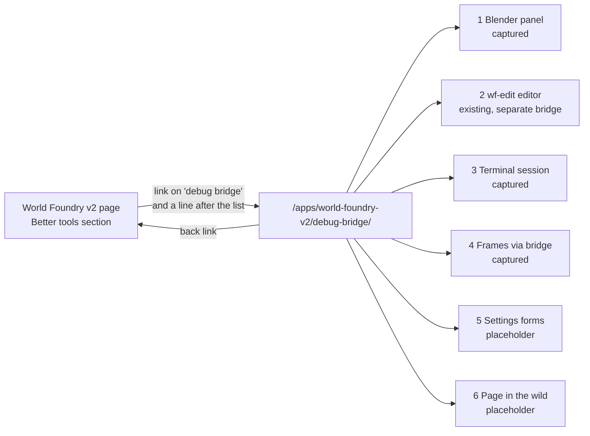
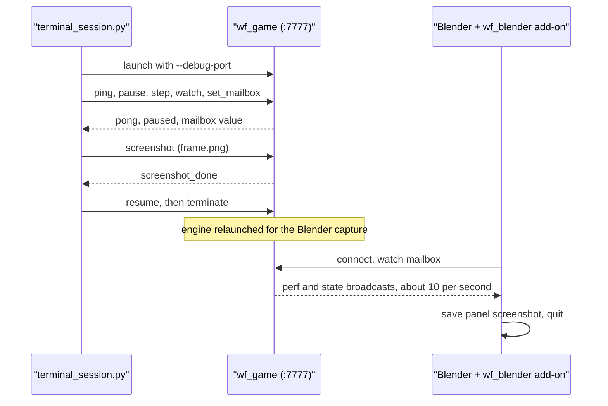
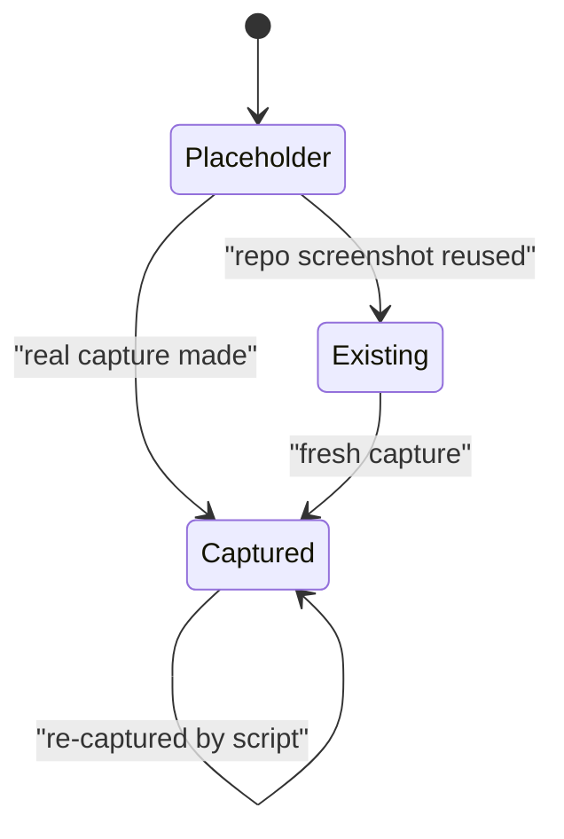
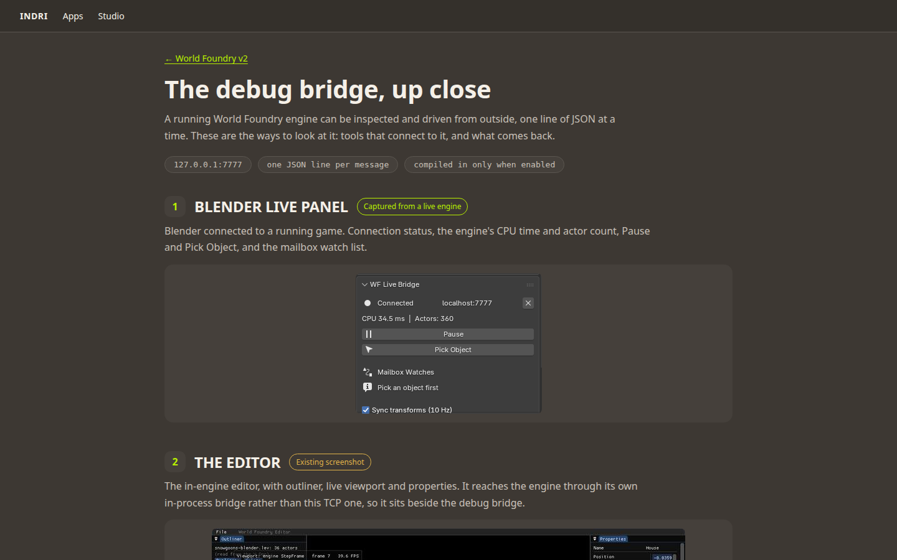
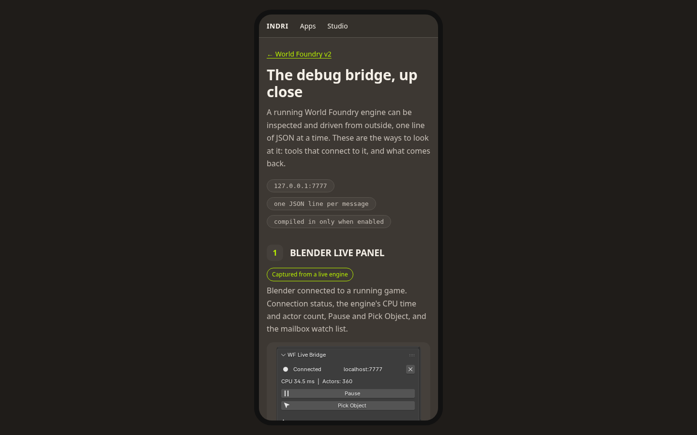

# World Foundry debug bridge page

31 October 2026 · **Proposed.** A dedicated page at `/apps/world-foundry-v2/debug-bridge/` that shows the engine's debug bridge from six angles, linked quietly from the World Foundry v2 page.

## Context

The World Foundry v2 page has a "Better tools for understanding each frame" section. On 2026‑10‑31 it was expanded to describe what the debug bridge does (watch, change, pick, drive input, pause and step, hot-reload, capture), from the engine source `engine/stubs/debug_server.cc`. A paragraph and a list say what it does but show nothing, and the bridge has no screen of its own. Will asked for a page that shows it.

Six ways to see it came up while looking for a bridge UI. They are not all equally real, and the page must say which are which:

| # | View | Status today | Evidence |
|---|---|---|---|
| 1 | Blender "WF Live Bridge" panel | **Captured** from a live engine | `blender-bridge-panel.png`, the Properties editor at its natural width (339 px) against `wf_game --debug-port 7777` |
| 2 | `wf-edit` editor | **Existing screenshot**, and **not the TCP bridge** | `engine/wf_edit/engine_bridge.h` describes a separate in-process "CRDT→engine bridge" that calls `wfmut::` directly |
| 3 | Terminal session | **Captured** | ping, pause, step, watch, set_mailbox, screenshot, resume against a live engine |
| 4 | Frames captured through the bridge | **Captured** | `frame.png`, written by the bridge's `screenshot` op |
| 5 | In-game settings forms (TV picker) | **Placeholder** | exists only as a design mockup labelled "MOCKUP – NOT SHIPPED" |
| 6 | The bridge section as a visitor sees it | **Placeholder** | needs a browser capture of the live page; none was possible this session |

## Approach

One new standalone Astro page, `src/pages/apps/world-foundry-v2/debug-bridge/index.astro`, on the `Base` layout. This is the same pattern as `src/pages/apps/finding-your-way/play/index.astro`. A standalone page, not an `apps` collection entry, because every collection entry becomes a homepage card and joins the app prev/next cycle (`src/pages/index.astro`, `src/pages/apps/[...slug].astro`). That would make the bridge look like an app. I rejected a nested collection entry for that reason.

- **Layout.** A back link, a title, a short lede, three small "at a glance" chips (`127.0.0.1:7777`, one JSON line per message, compiled in only when enabled), then six numbered views. Each view has a heading, a status chip (Captured, Existing screenshot or Placeholder), a one-line caption and its figure.
- **Honesty is the design.** Chips say what each view is. View 2's caption says it sits beside the debug bridge rather than being it. Placeholders are dashed boxes that say "Screenshot to come", never a fake image. The mockup file `editor.png` in the engine repo is not used: it is labelled not shipped.
- **Images** go through `astro:assets` like the other screenshots, from `src/assets/screenshots/world-foundry/bridge/` (`blender-bridge-panel.png`, `frame.png`, `wfedit-properties.png`, already copied in).
- **Narrow screens.** The Blender panel is captured at Blender's own narrow Properties-editor width (339 px), not a maximised area, so there is no blank space between the controls and it fits a phone with no scrolling or scaling. An earlier full-width capture (1030 px) was rejected: its buttons stretched across the area and the text became unreadable on a phone.
- **Terminal transcript** is a constant in the frontmatter rendered in a `<pre>`, because braces in an Astro template body are expressions.
- **Link from the World Foundry page**, in `src/content/apps/world-foundry-v2.mdx`: the words "debug bridge" in the section's first sentence become a link, plus one short line after the list ("See it in use: a Blender panel, a live terminal session and more."). Two plain inline links, no button or callout.
- **Reproducible captures.** `scripts/wf-bridge-captures/terminal_session.py` and `blender_panel.py` regenerate the terminal session, frame and Blender screenshot. Output goes to `$BRIDGE_OUT`. The script saves the whole Properties editor (`blender-panel.png`, 339×772); the bridge panel is cropped from it with ImageMagick: `convert blender-panel.png -crop 299x226+36+546 +repage blender-bridge-panel.png`.
- **No redirect change.** The Worker's `/apps/world-foundry/…` redirect only matches that exact prefix and does not touch `world-foundry-v2/…`.

### Flow: how a reader gets to each view



### Sequence: how the captured views were made

Order matters here because the engine must be listening before a client connects, and the engine is stopped afterwards.



### State: what a view can be

A view is promoted by replacing its placeholder or caption, not by changing the layout.



## Mockups

The page has a visible surface, so both states are mocked up with the real captures embedded. The desktop mockup is a live, scrollable page (all six views); the thumbnail is its first screen. The narrow one is the same page at phone width. Rebuild with `python3 -I docs/plans/2026-10-31-world-foundry-debug-bridge-page/build-mockups.py`.

[](2026-10-31-world-foundry-debug-bridge-page/bridge-page-desktop.html)

**Desktop.** [Open the interactive mockup](2026-10-31-world-foundry-debug-bridge-page/bridge-page-desktop.html) to scroll through all six views, including the terminal transcript, the engine frame and the two placeholders.

[](2026-10-31-world-foundry-debug-bridge-page/bridge-page-narrow.html)

**Narrow.** [Open the interactive mockup](2026-10-31-world-foundry-debug-bridge-page/bridge-page-narrow.html). The status chip wraps under the heading, and the Blender panel fits at its natural size.

Decision for you: the wording of the status chips and of view 2's caption (the "sits beside the debug bridge" line) is the part most worth reading.

## Out of scope

- Replacing placeholder 5 (settings forms). Blocked until the runtime object-editing feature ships; see the engine plan `2026-10-16-runtime-object-editing.md`.
- Replacing placeholder 6 with a real screenshot of the live page. Do it after the page is deployed; needs a working browser capture.
- A fresh capture of the Blender panel showing the Frame / Step / Resume row. The panel code draws it under conditions the capture did not hit.
- A capture of `wf-edit` going through its own bridge, or a build of `wf-edit` (no binary was found).
- A write-up of the bridge protocol on the page. The page shows it; the command reference lives in the engine repo.

## Verification

Run 2026‑10‑31 after `v0.1.277` deployed. Step 3's command was corrected from `grep -c` to `grep -o … | wc -l`: the built HTML is a single line, so `-c` would always print 1.

1. **Regenerate the mockups from the real captures.** Expect two `.html` files, each under 512 KB.

    ```
    python3 -I docs/plans/2026-10-31-world-foundry-debug-bridge-page/build-mockups.py
    ```

    ```
    wrote bridge-page-desktop.html bridge-page-narrow.html
    123723 bridge-page-desktop.png    (html files: ~109 KB each)
    ```

    **PASS**: both files written, about 109 KB each, under the 512 KB budget.

2. **Build the site.** Expect exit 0 and `dist/apps/world-foundry-v2/debug-bridge/index.html`.

    ```
    task build
    ```

    ```
    build exit=0
    13:45:30 [build] 176 page(s) built in 3m 4s
    dist/apps/world-foundry-v2/debug-bridge/index.html
    ```

    **PASS**: exit 0 and the page exists.

3. **The built page has six views, and the two placeholders.** Expect `6` then `2`.

    ```
    grep -o 'class="view[^"]*"' dist/apps/world-foundry-v2/debug-bridge/index.html | wc -l
    grep -o 'class="ph[^"]*"' dist/apps/world-foundry-v2/debug-bridge/index.html | wc -l
    ```

    ```
    6
    2
    ```

    **PASS**: six views, two placeholders.

4. **The World Foundry v2 page links to it.** Expect the link to appear.

    ```
    grep -o 'href="/apps/world-foundry-v2/debug-bridge/"' dist/apps/world-foundry-v2/index.html | sort -u
    ```

    ```
          2 href="/apps/world-foundry-v2/debug-bridge/"     (counted with sort | uniq -c)
    <a href="/apps/world-foundry-v2/debug-bridge/"><strong>debug bridge</strong></a>
    ```

    **PASS**: two links: the bold "debug bridge" in the first sentence and the "See it in use" line.

5. **It is not a homepage card.** Expect `0`.

    ```
    grep -c 'debug-bridge' dist/index.html
    ```

    ```
    0
    ```

    **PASS**: not on the homepage.

6. **Captures regenerate from the scripts.** Needs `engine/wf_game` built; expect `frame.png` and a transcript in the output directory.

    ```
    BRIDGE_OUT=$(mktemp -d) python3 -I scripts/wf-bridge-captures/terminal_session.py
    ```

    ```
    < {"op":"screenshot_done","filename":".../frame.png","w":640,"h":480}
    > {"op":"resume"}
    < {"op":"resumed"}
    frame.png exists: True
    53952 frame.png    1240 transcript.txt    (engine stopped afterwards)
    ```

    **PASS**: the script drove a live engine and wrote `frame.png` and `transcript.txt`. The Blender capture (`blender_panel.py`) was run earlier in the session, not in this step.

7. **After deploy the page is live and the old path still redirects.** Expect `200`, then `301` to the v2 URL.

    ```
    task publish
    ```

    Then request `https://indri.studio/apps/world-foundry-v2/debug-bridge/` and `https://indri.studio/apps/world-foundry/` and read the status codes.

    ```
    tagged v0.1.277; deploy workflow triggered.      (deploy run: completed success)
    WF page: icon-list 1 tiles 7 svgs 7 | bold link to bridge page: true | see-it-in-use link: true
    bridge page: 200 views 6 placeholders 2 imgs 3 title ok: true
    old page: 301 https://indri.studio/apps/world-foundry-v2/
    old asset: 301 https://indri.studio/apps/world-foundry-v2/debug.svg
    homepage mentions debug-bridge: false
    img 200 image/webp /_astro/blender-bridge-panel.C1Y7YKaZ_hiICS.webp
    img 200 image/webp /_astro/wfedit-properties.BicWLD14_Z1hFmxI.webp
    img 200 image/webp /_astro/frame.DDJKmGqb_ZBfbuI.webp
    ```

    **PASS**: the page is live with all three images loading, the icon rows are on the World Foundry page, and the old page and asset paths redirect with a 301.
