# Compare Will’s shortlist on the real Erawan page

Add a compact selector beneath the hero at `/apps/erawan/`, using the existing indri.studio colour tokens. P13 is the provisional first selection, with subtle motion. This is a comparison pass; a final choice remains open.

[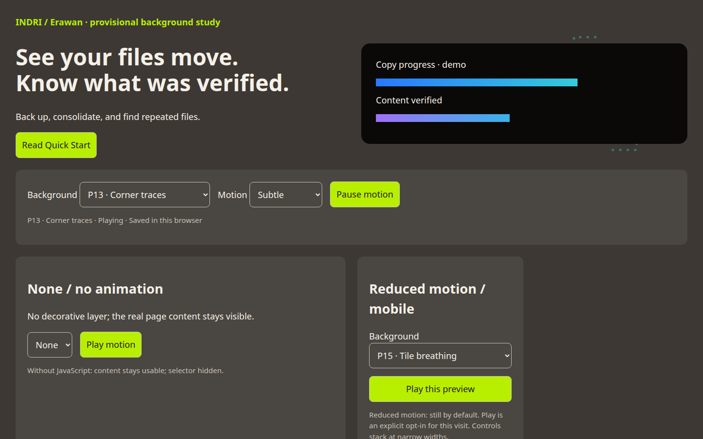](2026-11-12-erawan-background-selector/mockup.html)

## Choices and behavior

| ID | Background |
|---|---|
| None | No decorative background |
| P13 | Corner traces |
| P15 | Tile breathing |
| P16 | Gentle chevrons |
| P18 | Archive shelves |
| P19 | There and back |
| P22 | Route fan |
| P24 | Transfer tick field |
| P28 | Coverage quilt |
| P29 | Missing tile echo |
| P30 | Conflict branches |
| P38 | Duplicate mosaic |
| P40 | Fingerprint contours |

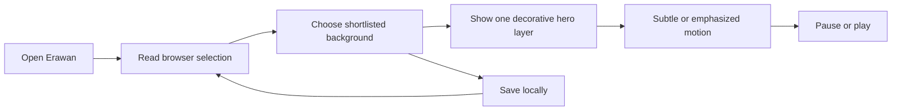

The background is decorative SVG behind stationary content. It cannot intercept links. The controls offer Subtle and Emphasized strength, plus Play/Pause; only one motif is visible. None removes it. Emphasized uses the v3 comparison settings: four times the speed and three times the travel/opacity. Mobile halves travel.

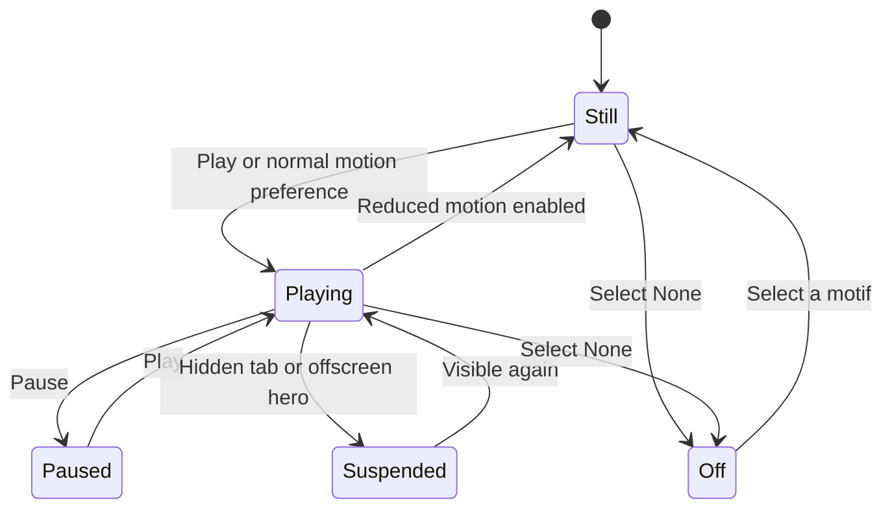

Reduced motion always starts still, even when a saved preference requested playback. Explicit Play opts in for this visit only. Local storage failures keep the selector usable for the current visit. Invalid saved values fall back to P13. Astro page navigation tears down listeners and reinitializes the component on return. Without JavaScript the content is unchanged and the selector stays hidden.

## Verification

1. Build the site and run its existing test suite.

```text
$ task build
23:01:55 [build] 178 page(s) built in 3m 30s
23:01:55 [build] Complete!
$ pnpm test
# tests 23
# suites 0
# pass 23
# fail 0
# cancelled 0
# skipped 0
# todo 0
```

PASS.

2. Check all 12 selections, None, persistence, pause/play, reduced motion, blocked storage, Astro navigation, and mobile layout in Chrome.

```text
$ python3 docs/plans/2026-11-12-erawan-background-selector/verify-browser.py http://localhost:4321/apps/erawan/
PASS: exactly 12 shortlisted choices plus None; each selected motif visibly animates.
PASS: pause/reload, saved choice/strength, None, and offscreen suspension.
PASS: Astro navigation away and back restores one working component.
PASS: mobile fit, reduced-motion opt-in/reset, blocked/invalid storage, and no-JS content.
```

PASS. Actual built-page captures:

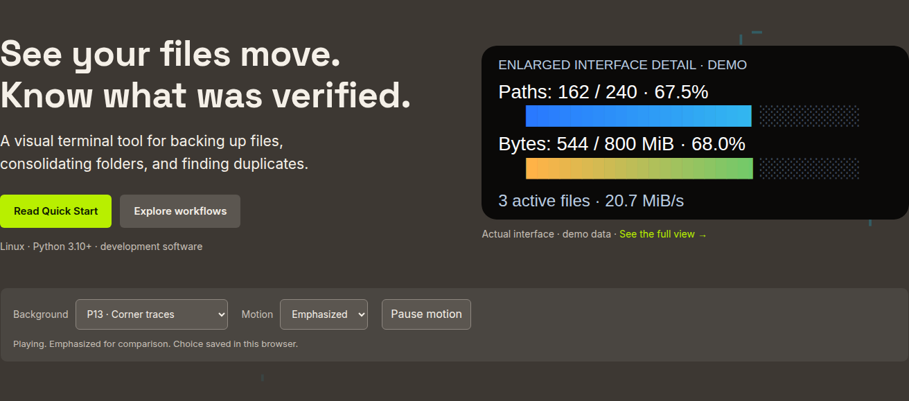

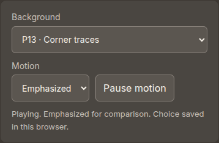


3. Publish through the existing tag deployment and verify the live Erawan route.

```text
$ task publish
publishing v0.1.289 on main (94d62b7)
tagged v0.1.289; deploy workflow triggered.
$ gh run watch 43256416020 --interval 30 --exit-status
✓ deploy in 6m10s (ID 131315742650)
PASS: live HTTPS page returns 200; exact 12 choices plus None; P19 animation and saved selection work; no JavaScript errors.
```

PASS: [live Erawan page](https://indri.studio/apps/erawan/), [deployment run](https://github.com/wbniv/indri.studio/actions/runs/43256416020). The optional Lighthouse stage reached Erawan, then stopped on the Foundry Linux route returning HTTP 404; its combined reports were skipped. This is not a full Lighthouse pass. The production build, existing tests, deployment, and explicit browser checks passed.

## Remaining decision

- [x] Will chose P30, emphasized motion, and 75% simulation opacity on 2026-11-13; remove the comparison selector.


## 2026-11-13 · background throughout the page

The hero-local layer disappears when scrolling and its observer pauses animation. Move the component to the Erawan page wrapper. Use a fixed viewport layer with mirrored left/right artwork, a softer reading area in the middle, and no pointer interception. Observe the whole Erawan wrapper; pause only outside that page or in a hidden tab. Keep normal content and terminal panels above the decoration.

A compact **Background · P13** disclosure stays at the lower left. Expanding it exposes the existing selector, motion strength and pause button. It collapses to a single button on mobile as well. The existing None, stored choices, and reduced-motion behavior remain available.

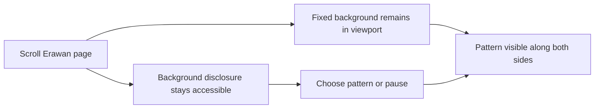

[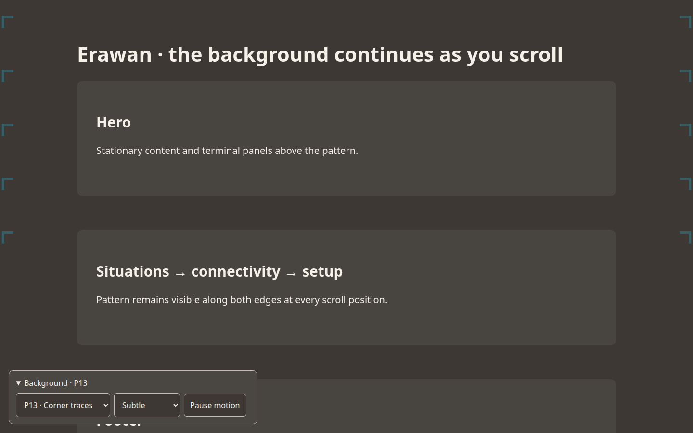](2026-11-12-erawan-background-selector/scroll-layout.html)

- [x] Verified animated viewport-sized backgrounds and reachable controls at the hero, situations, connectivity matrix, wizard and footer on desktop (1440 px) and mobile (390 px).
- [x] Published `v0.1.293` from `9592d95`; verified the live page on desktop and mobile.

Validation: `pnpm test` passed all 23 tests; `task build` passed (179 routes). Browser checks passed all 12 choices plus None, persisted preferences, pause/resume, Astro navigation, reduced-motion opt-in/reset, blocked/invalid storage, no-JS content, and mobile overflow. Fixed the footer stacking overlap found in the first browser pass. Inspected the default subtle appearance and emphasized comparison screenshots.

[Default subtle appearance](2026-11-12-erawan-background-selector/scroll-default.png) · [Desktop comparison](2026-11-12-erawan-background-selector/scroll-1440.png) · [Mobile](2026-11-12-erawan-background-selector/scroll-390.png) · [Expanded controls](2026-11-12-erawan-background-selector/scroll-mobile-controls.png).

Live verification: HTTP 200, fixed animated backgrounds after scrolling to the connectivity matrix and footer, clickable footer selector, all 12 choices plus None, saved selection after reload, and no JavaScript errors. [Release deployment](https://github.com/wbniv/indri.studio/actions/runs/43351147725): tests, build, Cloudflare upload and propagation succeeded; optional site-wide Lighthouse auditing was still running when this verification completed.


## 2026-11-13 · scroll with the content

Will rejected the viewport-fixed graphics. Replace the fixed layer with an absolute layer spanning the Erawan document. Repeat each animated SVG motif every 800 px down both sides; the pattern moves upward with the content during scrolling, while its own animation continues. Keep the compact selector reachable. Existing choices, pause, None and reduced-motion behavior remain.

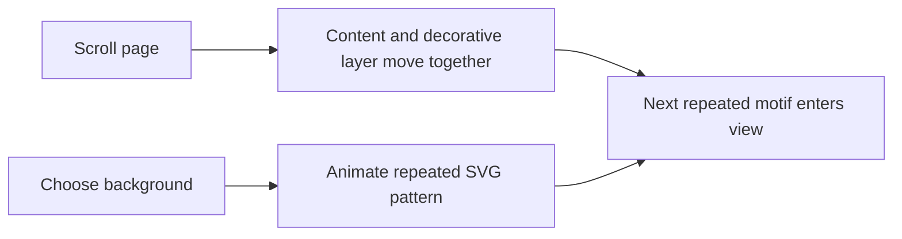

[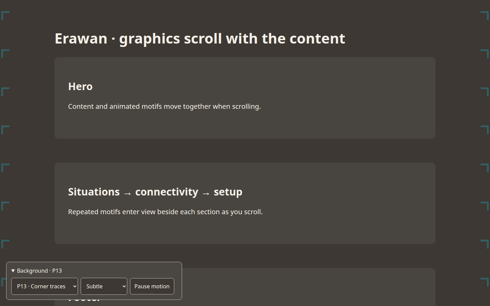](2026-11-12-erawan-background-selector/document-scroll.html)

- [x] Verify that a 300 px scroll moves the decorative layer by 300 px, repeated motifs cover the document, and controls still work on desktop and mobile.
- [x] Published `v0.1.294` from `69088be`; live desktop/mobile checks passed: document-attached graphics scroll 300 px with the content, and footer controls work. [Deployment](https://github.com/wbniv/indri.studio/actions/runs/43357429868).


```text
$ task build
[build] 179 page(s) built in 4m 49s
[build] Complete!
$ python3 docs/plans/2026-11-12-erawan-background-selector/verify-browser.py http://localhost:4321/apps/erawan/
PASS: exactly 12 shortlisted choices plus None; each selected motif visibly animates.
PASS: pause/reload, saved choice/strength, None, and continued animation after scrolling past the hero.
PASS: Astro navigation away and back restores one working component.
PASS: backgrounds cover the document and move 300px with a 300px scroll; animation and footer selector work on desktop/mobile.
PASS: mobile fit, reduced-motion opt-in/reset, blocked/invalid storage, and no-JS content.
```

PASS: [desktop](2026-11-12-erawan-background-selector/document-scroll-1440.png), [mobile](2026-11-12-erawan-background-selector/document-scroll-390.png), and [default subtle view](2026-11-12-erawan-background-selector/document-scroll-default.png) show repeated artwork at the connectivity section.


## 2026-11-13 · adjustable simulation surfaces

Add **Simulation opacity** to the Background disclosure: 0–100%, initially 70%, with a live percentage. Apply it to the workflow cards and the simulation's stage, endpoint, file, metrics, review and outcome backgrounds. Keep foreground text, controls, progress bars and status borders opaque. Save the choice in the existing browser preference; invalid or absent opacity falls back to 70%.

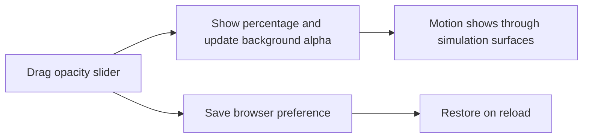

[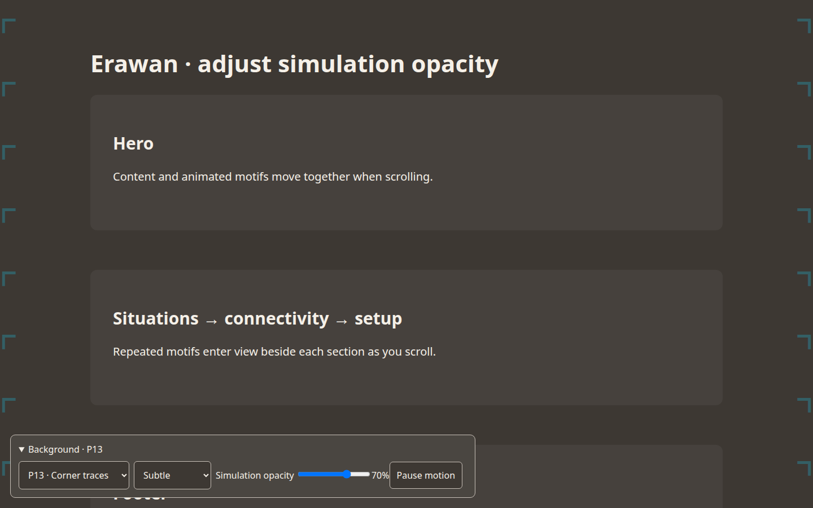](2026-11-12-erawan-background-selector/simulation-opacity.html)

- [x] Check 0%, 50%, 100%, keyboard control, persistence, and opaque text on desktop/mobile.
- [x] Published `v0.1.295` from `f449dfb`; verified live document scrolling, opacity endpoints, and saved slider values on desktop and mobile. [Deployment](https://github.com/wbniv/indri.studio/actions/runs/43359651171).


```text
$ task build
[build] 179 page(s) built in 5m 13s
[build] Complete!
$ python3 docs/plans/2026-11-12-erawan-background-selector/verify-browser.py http://localhost:4321/apps/erawan/
PASS: simulation opacity endpoints, keyboard adjustment, saved value, opaque foreground, and desktop/mobile fit.
PASS: exactly 12 shortlisted choices plus None; each selected motif visibly animates.
PASS: pause/reload, saved choice/strength, None, and continued animation after scrolling past the hero.
PASS: Astro navigation away and back restores one working component.
PASS: backgrounds cover the document and move 300px with a 300px scroll; animation and footer selector work on desktop/mobile.
PASS: mobile fit, reduced-motion opt-in/reset, blocked/invalid storage, and no-JS content.
```

PASS: visually reviewed 50% opacity on [desktop](2026-11-12-erawan-background-selector/simulation-opacity-1440.png) and [mobile](2026-11-12-erawan-background-selector/simulation-opacity-390.png).

Live verification passed after waiting for keyboard-driven values to settle; the initial immediate value read failed once. CI tests, build, Cloudflare upload and propagation passed. Optional site-wide Lighthouse auditing was still running at the time of this check.


## 2026-11-13 · final settings

Lock P30 (Conflict branches), emphasized motion, and 75% simulation background opacity. Remove the entire preview disclosure, sliders, selectors, storage logic, and unused candidate patterns. Existing browser preview preferences no longer affect the page. Keep document scrolling and reduced-motion support; a hidden tab pauses decoration.

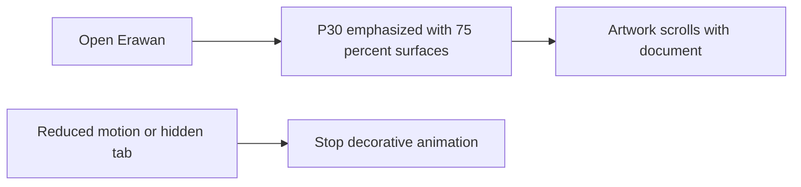

[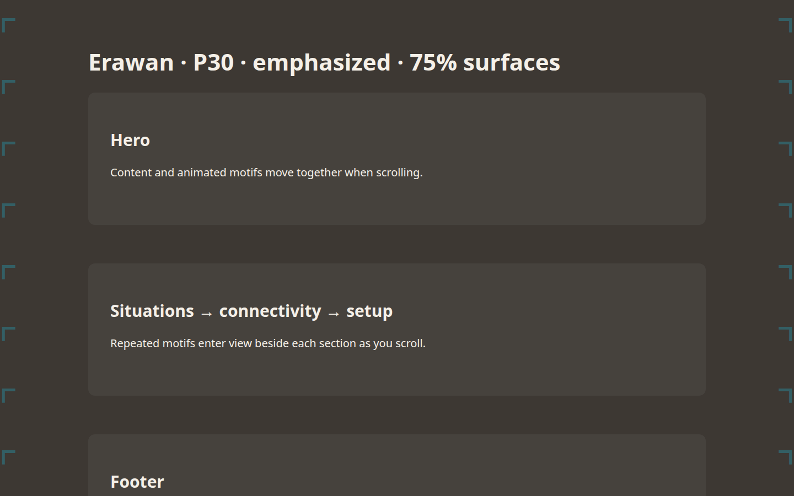](2026-11-12-erawan-background-selector/final-settings.html)

- [x] Verify final values, no preview controls or preference overrides, desktop/mobile scrolling and reduced motion.
- [ ] Publish and verify live.


```text
$ task build
[build] 179 page(s) built in 4m 52s
[build] Complete!
$ python3 docs/plans/2026-11-12-erawan-background-selector/verify-browser.py http://localhost:4321/apps/erawan/
PASS: P30 emphasized, 75% surfaces, opaque foreground, no preview controls, and old preferences ignored.
PASS: desktop/mobile document scrolling, client navigation, reduced-motion changes, and no-JS content.
```

PASS: reviewed final [desktop](2026-11-12-erawan-background-selector/final-settings-1440.png) and [mobile](2026-11-12-erawan-background-selector/final-settings-390.png) screenshots.
