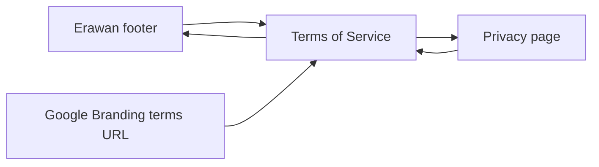
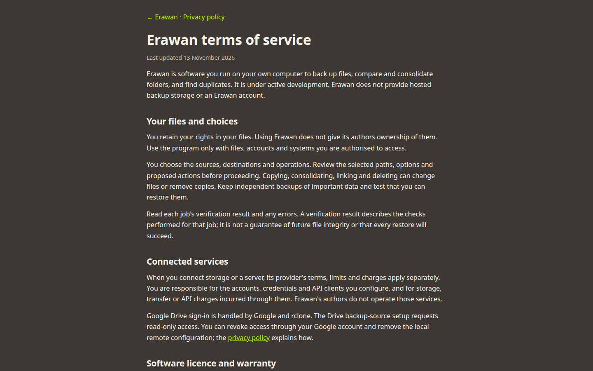

# Erawan Terms of Service

Publish `/apps/erawan/terms/` alongside the existing privacy policy. Will requested the other policy named on Google's consent screen after completing client-reuse verification.

Use the same readable single-column layout as Privacy. State that Erawan runs locally, users retain their files, file-changing actions require care, and configured providers have their own terms and charges. Reproduce the repository's MIT licence verbatim, preserving its copyright holder. These usage notes do not narrow the MIT permissions. Link Privacy and the application home page; add Terms to the landing-page footer and privacy-page navigation.



[](2026-11-13-erawan-terms/terms.html)

Google's branding guidance explains that policy links may remain hidden while branding is unverified. Publishing a URL is separate from configuring it in the Cloud Console. [Google guidance](https://developers.google.com/identity/protocols/oauth2/production-readiness/brand-verification). Licence reference: Erawan's `LICENSE` and the [MIT licence](https://opensource.org/license/mit).

- [x] Build and check the terms page and navigation at desktop/mobile widths.
- [x] Publish, verify the public URL, and open it for Will.


```text
$ task build
[build] 180 page(s) built in 3m 7s
[build] Complete!
$ python3 docs/plans/2026-11-13-erawan-terms/verify-browser.py http://localhost:4321
PASS: terms HTTP 200, exact repository MIT licence, contact link, desktop/mobile fit, and reciprocal Home/Privacy/Terms navigation.
```

PASS: inspected [desktop](2026-11-13-erawan-terms/terms-1440.png) and [mobile](2026-11-13-erawan-terms/terms-390.png) screenshots.


Published as `v0.1.297`, source commit `58b21a2`. [Deployment](https://github.com/wbniv/indri.studio/actions/runs/43373668361) succeeded, including tests, build, upload and propagation. Optional Lighthouse report/budget stages were skipped; this is not a recorded Lighthouse score.

```text
$ python3 docs/plans/2026-11-13-erawan-terms/verify-browser.py https://indri.studio
PASS: terms HTTP 200, exact repository MIT licence, contact link, desktop/mobile fit, and reciprocal Home/Privacy/Terms navigation.
```

PASS: [live Terms of Service](https://indri.studio/apps/erawan/terms/). This is the URL for Google Auth Platform → Branding → Application terms of service. The Cloud Console field itself was not changed in this task.
