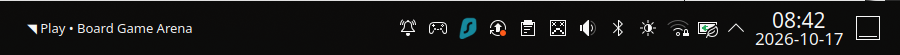

[View the full panel screenshot](https://github.com/wbniv/bga-title-tray/blob/main/codex/screenshots/bga-title-tray-working.png).

The title of your selected [Board Game Arena](https://boardgamearena.com/) tab lives beside the KDE system tray. When a game offer arrives while BGA is in the background, the padded title area flashes white with black text. It keeps flashing until the BGA tab is focused or the offer goes away. Click the title to bring that existing tab to the front.

This is an independent companion for Board Game Arena, not a Board Game Arena product. It uses a Chrome extension to read the tab title and the visible game-offer and lobby states, plus a small local host and Plasma widget to display them. It does not show a separate desktop notification.

<a class="download-cta" href="https://github.com/wbniv/bga-title-tray/releases/latest">Download the latest release ↗</a>

## Supported setup

Linux with **KDE Plasma 6** and **Google Chrome or Chromium**. The installer also needs Python 3 with PyQt6, `socat`, `kpackagetool6`, and `qdbus6`; your distribution's package manager may use different package names. Other desktops, browsers, Windows, and macOS are not supported by this release.

## Install

1. On the [latest release page](https://github.com/wbniv/bga-title-tray/releases/latest), download the `.tar.gz` archive and its adjacent `.sha256` file. Verify the archive using the checksum command in the package's illustrated guide.
2. Extract the archive and open `START_HERE.html` in your browser. It shows the commands and screenshots for your browser. Run `./bin/install.sh --browser chrome` from the extracted folder, or choose `chromium` for Chromium. The installer prints the extension folder to select.
3. Open Chrome's [Extensions page](chrome://extensions/), enable **Developer mode**, click **Load unpacked**, and choose the printed folder. If that link is blocked, paste `chrome://extensions/` into Chrome's address bar. Open or refresh a [Board Game Arena](https://boardgamearena.com/) tab; its title should appear beside the Plasma system tray.

The release archive includes an illustrated HTML guide with screenshots of the installed extension and the working tray. No Markdown viewer is needed. For updates and removal, follow the guide or the [project's installation notes](https://github.com/wbniv/bga-title-tray/blob/main/codex/INSTALL.md).
